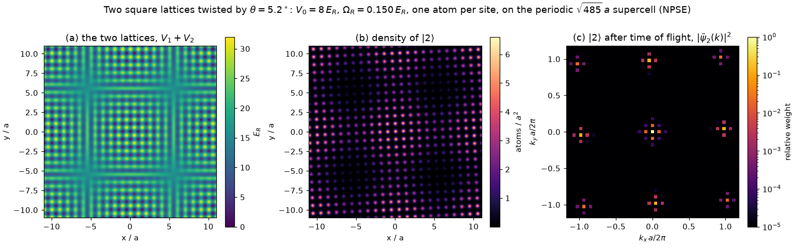

# twisted-bilayer — a two-component Gross–Pitaevskii solver for BECs in twisted-bilayer optical lattices

[](LICENSE)
[](pyproject.toml)

`twisted-bilayer` solves the two-component Gross–Pitaevskii equation for a Bose–Einstein condensate held in
two square optical lattices twisted against each other, one lattice per hyperfine state, coupled by a
microwave field. It is written in PyTorch and runs on CPU and CUDA. The model follows the experiment of
Meng *et al.*,
[*Atomic Bose–Einstein condensate in twisted-bilayer optical lattices*, Nature **615**, 231 (2023)](https://doi.org/10.1038/s41586-023-05695-4):
⁸⁷Rb, lattice constant a = 395 nm, twist angle θ = 5.2°, a pancake-shaped vertical trap. In lattice units
(a = E_R = ħ = 1, so m = π²/2; E_R = h × 3678.38 Hz, time unit ħ/E_R = 43.27 µs):

```math
i\,\partial_t \psi_{1,2} = \Big[-\tfrac{1}{\pi^2}\nabla^2 + V_{1,2}(\mathbf r) \pm \tfrac{\Delta}{2} + g\,n\Big]\psi_{1,2} + \Omega_R\,\psi_{2,1},
\qquad n = |\psi_1|^2 + |\psi_2|^2 .
```

Ω_R is the off-diagonal matrix element (a bare two-level atom oscillates as sin²(Ω_R t)).



*The experiment's moiré supercell at V₀ = 8 E_R, Ω_R = 0.150 E_R, one atom per site: (a) the two lattices,
(b) the ground-state density of |2⟩, (c) its momentum distribution, with the Bragg peaks of both lattices and
the moiré satellites. Drawn by [`scripts/readme_figures.py`](scripts/readme_figures.py).*

**What it computes.** Ground states on the exactly periodic moiré supercell (tan(θ/2) = n/m) and of trapped
clouds; real-time evolution; the superfluid fraction from a phase twist, with Leggett's bounds; moiré
contrasts as an absorption image shows them; time of flight; Bogoliubov–de Gennes modes. The vertical
direction runs in full 3D or is folded into 2D by the NPSE. Mean field throughout. The lattice (Bose–Hubbard)
models of the same system are a separate package,
[Twisted-Bilayer-Lattice-models](https://github.com/VaclavSvo/Twisted-Bilayer-Lattice-models).

## Installation

Python 3.10 or newer. Install PyTorch first ([pytorch.org](https://pytorch.org/get-started/locally/) has the
command for your CUDA version; a plain `pip install torch` on Linux pulls a CUDA build of about 6 GB), then:

```bash
git clone https://github.com/VaclavSvo/3D-GPE-Twisted-Bilayer-optical-lattices.git
cd 3D-GPE-Twisted-Bilayer-optical-lattices
pip install -e ".[dev]"            # numpy, scipy, matplotlib, threadpoolctl + pytest, ruff
```

## Quick start

```bash
twisted-bilayer run coupling_scan_quick      # ~15 s on 2 CPU cores; files in results/coupling_scan_quick/
twisted-bilayer gates                        # the quick physics gates
python check.py                              # lint + the test suite
```

## Scenarios

`twisted-bilayer list` shows every named run; `twisted-bilayer run NAME` runs one (`--128` for complex128
throughout, `--cpu` to stay on the CPU, `--scenarios FILE` for rows of your own). A selection:

| name | what it computes | time (2 CPU cores) |
| --- | --- | --- |
| `coupling_scan_quick` | superfluid fraction, Leggett bounds, μ and pocket formation against the coupling | 15 s |
| `trapped_quick` | a small trapped cloud: local-density start, ground state, contrasts as imaged | 10 s |
| `rabi_quick` | real-time Rabi transfer between the two states inside the lattice | 15 s |
| `trapped_3d_quick` | a small trapped cloud in full 3D against the NPSE and fixed-g quasi-2D models | 20 s |
| `bdg` | Bogoliubov–de Gennes modes: sound speed and the spin branch | 1.5 min |
| `coupling_scan_v4`, `trapped` | the same on the experiment's supercell (θ = 5.2°) | 6 min |
| `gpu_check`, `gpu_3d_vs_2d`, `gpu_precision` | GPU against CPU; the 3D cloud as large as the GPU holds; complex64 against complex128 | GPU |

The quick rows use a small tan(θ/2) = 1/4 cell; they check that everything works, not the experiment's
geometry. The full table, the exit codes and the GPU runs are in [`docs/methods.md`](docs/methods.md).

## Validation

77 physics gates check the engine against analytic results, exact identities, and numbers reproduced by the
author's earlier, separately written quasi-2D and 3D solvers; all 77 pass (full settings, complex128).
A selection from [`docs/validation.md`](docs/validation.md), which lists every gate and what it is checked
against:

| check | error | reference |
| --- | --- | --- |
| harmonic oscillator: ground-state widths (2D) | 1.2 × 10⁻¹³ | exact |
| free expansion of a Gaussian, σ(t) | 1.9 × 10⁻¹³ | exact |
| detuned two-level Rabi oscillation, N₂/N(t) | 7.8 × 10⁻¹⁶ | exact |
| band bottom of V₀ sin²(πx) at 4 E_R, on the √485 supercell | 6.2 × 10⁻¹² | plane-wave diagonalisation |
| gauge symmetry H(−Ω_R) = σ_z H(Ω_R) σ_z, energy | 3.2 × 10⁻¹⁶ | exact identity |
| time reversal dt → −dt after 400 steps | 6.2 × 10⁻¹⁴ | exact identity |
| superfluid fraction, twist energy against twist current | 4.1 × 10⁻⁵ | consistency of the two estimators |
| dressed band bottom at Ω_R = 0.24277 E_R | 2.2 × 10⁻¹⁰ | regression pin (earlier solvers) |
| chemical potential at Ω_R = 0.24277 E_R, one atom per site | 1.8 × 10⁻⁷ | regression pin (earlier solvers) |

## Documentation

- [`docs/methods.md`](docs/methods.md): how the engine works, using it from Python, units, every scenario, the
  check panels, GPU runs, the 3D reference against the quasi-2D models, the repository layout, limitations,
  references.
- [`docs/validation.md`](docs/validation.md): every physics gate with its result and reference.
- [`CHANGELOG.md`](CHANGELOG.md) and the [examples](examples/).

## How this was built

The physics, the model choices and the validation design are the author's. The implementation was
AI-assisted, written under the author's direction and reviewed by him. What the author stands behind is the
validation: the physics gates, the test suite and the pinned reference numbers make any unexplained change in
a result fail `python check.py`.

## Citing, licence and author

If you use this code, please cite it via [`CITATION.cff`](CITATION.cff), and the experiment it models. MIT
licence; see [`LICENSE`](LICENSE).

Václav Svoboda, MSc Mathematical Physics, University of Vienna; Wolfgang Pauli Institute, Vienna (Mauser group).
