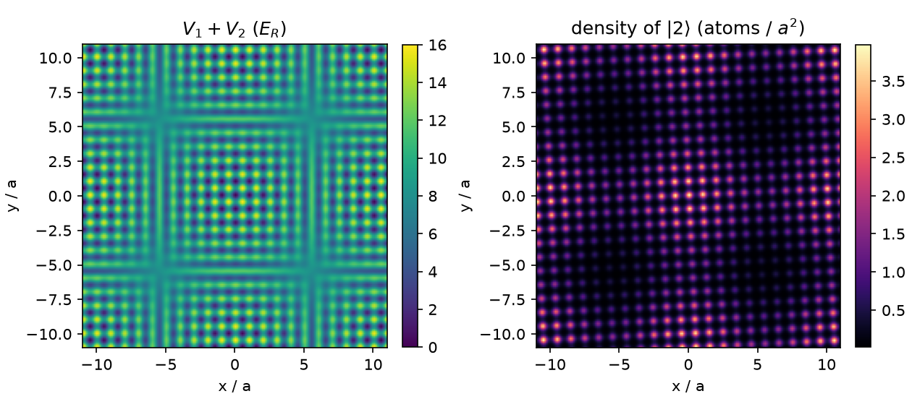
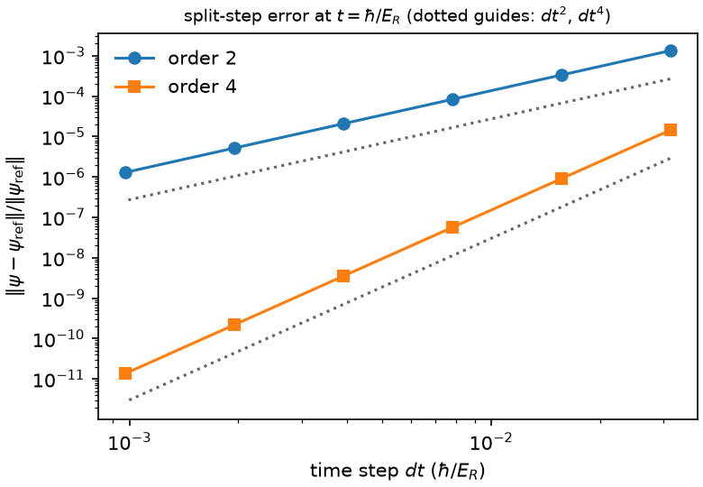

# twisted-bilayer — a two-component Gross–Pitaevskii solver for BECs in twisted-bilayer optical lattices

[](LICENSE)
[](pyproject.toml)

`twisted-bilayer` solves the two-component Gross–Pitaevskii equation for a Bose–Einstein condensate held in
two square optical lattices twisted against each other, one lattice per hyperfine state, coupled by a
microwave field. It is written in PyTorch and runs on CPU and CUDA. It covers the exactly periodic moiré
supercell, trapped clouds, real-time dynamics, and time of flight with absorption imaging. The engine is
checked by 89 physics gates, all passing ([docs/validation.md](docs/validation.md)).

The model follows the experiment of Meng *et al.*,
[*Atomic Bose–Einstein condensate in twisted-bilayer optical lattices*, Nature **615**, 231 (2023)](https://doi.org/10.1038/s41586-023-05695-4):
⁸⁷Rb in |F=1, m_F=1⟩ and |F=2, m_F=0⟩, lattice constant a = 395 nm, twist angle θ = 5.2°, and a
pancake-shaped vertical trap, treated in full 3D or folded into 2D. In lattice units (a = E_R = ħ = 1, so
m = π²/2):

```math
i\,\partial_t \psi_{1,2} = \Big[-\tfrac{1}{\pi^2}\nabla^2 + V_{1,2}(\mathbf r) \pm \tfrac{\Delta}{2} + g\,n\Big]\psi_{1,2} + \Omega_R\,\psi_{2,1},
\qquad n = |\psi_1|^2 + |\psi_2|^2 .
```

Ω_R is the off-diagonal matrix element, so a bare two-level atom oscillates as sin²(Ω_R t). The paper's
2π × 893 Hz is Ω_R = 0.24277 E_R. The scope is mean field: ground states, real-time evolution, Bogoliubov
excitations, and a tight-binding cross-check.

<p align="center"></p>

*Left: the sum of the two lattice potentials on the periodic supercell (θ = 5.2051°, side √485 a, 2 × 2
moiré cells). Right: the density of |2⟩ in the ground state at V₀ = 4 E_R, Ω_R = 0.24277 E_R, one atom per
lattice site, with the NPSE vertical reduction on a 176 × 176 grid. `python examples/01_ground_state.py`
makes this figure in about 15 seconds on 2 CPU cores.*

## Highlights

- **Exact local step.** The split-step Fourier solver exponentiates the local 2 × 2 Hamiltonian exactly, so
  operator splitting is the only time-step error. The Strang (order 2) and Yoshida (order 4) compositions
  converge with fitted slopes 2.00 and 4.00, and the norm is conserved to 10⁻¹³
  ([example 3](examples/03_time_step_convergence.py)).
- **Batched parameter sweeps.** The coupling Ω_R, the detuning, the interaction and the phase twist can be
  tensors with a batch axis, so a whole scan relaxes in one set of FFT calls on the GPU.
- **Superfluid fraction with bounds.** A phase twist Φ across the box, the same on both components, gives
  f_s from the twist energy and from the twist current. The two estimators are related by
  Hellmann–Feynman, so their agreement (4 × 10⁻⁵ at Φ = 0.2) checks the twisted ground state. Leggett's
  upper and lower bounds, computed from the untwisted density, bracket the result.
- **One engine in 1D, 2D and 3D.** The grid, the split-step propagator, the ground-state solver and the
  energy, current and superfluid-fraction observables work on any number of spatial axes, so the full 3D
  problem with the vertical trap runs on the same code as the 2D reduction and the 1D toy models. The
  imaging observables are 2D (column densities). The tests include 3D real-time runs and the NPSE checked
  against full 3D.
- **Exactly periodic moiré cells.** Commensurate twists tan(θ/2) = n/m give a periodic square box. The
  experiment's angle is n/m = 1/22.
- **More than one model.** The vertical direction can be folded into 2D by the NPSE, a reduction that is
  checked against the full 3D solution. The package also covers trapped clouds from a local-density start,
  Bogoliubov–de Gennes modes, a two-layer Bose–Hubbard mean field, and the time-of-flight and coherent
  absorption-imaging pipeline.
- **Physics gates.** 89 gates check the engine against analytic results, exact identities, and numbers
  reproduced by the author's earlier, separately written quasi-2D and 3D solvers. Those solvers are not
  distributed; their values and tolerances are pinned in
  [`gates/references.py`](src/twisted_bilayer/gates/references.py).

## Validation

A selection from `twisted-bilayer gates --full --trapped`: 89 gates, all passing, on the CPU in complex128,
in about 6.5 minutes on 2 CPU cores. The full table is in [docs/validation.md](docs/validation.md).

| check | error | reference |
| --- | --- | --- |
| harmonic oscillator: ground-state energy and widths (2D) | 1.2 × 10⁻¹³ | exact |
| free expansion of a Gaussian, σ(t) | 1.8 × 10⁻¹³ | exact |
| detuned two-level Rabi oscillation, N₂/N(t) | 1.1 × 10⁻¹⁵ | exact |
| band bottom of V₀ sin²(πx) at 4 E_R, on the √485 supercell | 6.2 × 10⁻¹² | plane-wave diagonalisation |
| Bloch weight \|c₀\|⁴ at 4 E_R | 4.9 × 10⁻⁹ | plane-wave diagonalisation |
| gauge symmetry H(−Ω_R) = σ_z H(Ω_R) σ_z | 1.6 × 10⁻¹⁶ | exact identity |
| time reversal dt → −dt after 400 steps | 7.3 × 10⁻¹⁴ | exact identity |
| superfluid fraction, twist energy against twist current | 4.1 × 10⁻⁵ | consistency of the two estimators |
| dressed band bottom at Ω_R = 0.24277 E_R | 2.2 × 10⁻¹⁰ | author's quasi-2D and 3D solvers |
| chemical potential at Ω_R = 0.24277 E_R, one atom per site | 1.8 × 10⁻⁷ | author's quasi-2D solver |

<p align="center"></p>

*Real-time error after t = ħ/E_R for a Rabi transfer in the lattice, against a fine-step reference. The
dotted lines are dt² and dt⁴. `python examples/03_time_step_convergence.py` makes it in about 15 seconds.*

## Installation

Python 3.10 or newer; tested with Python 3.13 on Linux and Windows.

```bash
git clone https://github.com/VaclavSvo/3D-GPE-Twisted-Bilayer-optical-lattices.git
cd 3D-GPE-Twisted-Bilayer-optical-lattices
python -m venv .venv
source .venv/bin/activate          # Windows (PowerShell): .venv\Scripts\Activate.ps1
```

Then install PyTorch, choosing one of the two lines, and the package:

```bash
pip install torch --index-url https://download.pytorch.org/whl/cpu      # CPU only
pip install torch --index-url https://download.pytorch.org/whl/cu128    # NVIDIA GPU (CUDA 12.8)
pip install -e ".[dev]"            # numpy, scipy, matplotlib, threadpoolctl + pytest, ruff
```

For another CUDA version, take the command from [pytorch.org](https://pytorch.org/get-started/locally/).
On Linux, a plain `pip install torch` pulls the CUDA build (an environment of about 6 GB), so pick the CPU
line if you have no GPU. `pip install .` (not editable) works as well.

## Quick start

```bash
twisted-bilayer list                          # the scenarios
twisted-bilayer run coupling_scan_quick       # ~15 s; files in results/coupling_scan_quick/
twisted-bilayer run rabi_quick --out runs     # files in runs/rabi_quick/
twisted-bilayer gates                         # the quick physics gates (79), ~45 s
python check.py                               # lint + the 183 tests
python check.py --all                         # + the quick gates as one slow test, ~1 min more
pytest tests/test_kinetic.py                  # one test file
```

`check.py` takes about 5 minutes on 2 laptop CPU cores and about 2 minutes on a desktop. The tests run on
the CPU in complex128.

`coupling_scan_quick` finds the ground state at five couplings in one batch. For each, it measures the
superfluid fraction, the Leggett bounds and how the atoms gather into the moiré pockets. It writes a
six-panel figure, a table, the full `.csv`, the wave functions, and a `provenance.json` with the package
version, git commit, library versions and device:

```
 Omega_R  Omega_over_J  E_per_N      mu  fs_xx_energy  fs_xx_current  leggett_x_lower  leggett_x_upper
       0             0   4.9885  5.0045       0.28253        0.28244          0.26673          0.99882
     0.1        3.2468   4.9272   4.944       0.30064        0.30055          0.26609          0.99537
    0.24        7.7924   4.8347  4.8541       0.31178        0.31168          0.25726          0.96279
     0.5        16.234   4.6457  4.6729       0.30305        0.30292          0.22821          0.85176
       1        32.468   4.2367  4.2855       0.24014        0.23994          0.16413          0.59207
```

Energies are in E_R. `Omega_over_J` is Ω_R/J₁, where J₁ = 0.0308 E_R is the nearest-neighbour hopping of one
lattice at V₀ = 8 E_R. `fs_xx` is the superfluid fraction along the box x axis.

The quick scenarios use the small tan(θ/2) = 1/4 cell (θ = 28°), so they finish in seconds. Use them to
check that everything works; they do not reproduce the experiment's geometry.

## Using the engine from Python

```python
from twisted_bilayer.engine import NPSE2D, BilayerGPE, Grid, bilayer_potential, initial_state, lattice_units
from twisted_bilayer.engine import moire_geometry, relax

geo = moire_geometry(22, 1)  # tan(theta/2) = 1/22: theta = 5.2051 deg, box side sqrt(485) a
N = geo.grid_size(8)  # 8 grid points per lattice constant
grid = Grid((N, N), (geo.L_box, geo.L_box))
lu = lattice_units()  # Rb-87, a = 395 nm, 1 kHz vertical trap
eng = BilayerGPE(grid, V=bilayer_potential(grid, 4.0, geo), Omega_R=0.24277, interaction=NPSE2D(lu.g2d, lu.omega_z))

n_atoms = geo.L_box**2  # one atom per lattice site
r = relax(eng, initial_state(eng, n_atoms), n_atoms, tol=1e-9)
print(f"mu = {float(r.mu[0]):.6f} E_R, residual {float(r.residual[0]):.0e}")
n = (r.psi[0].abs() ** 2).cpu().numpy()  # (2, N, N): the densities of the two states
```

```
mu = 2.908446 E_R, residual 7e-10
```

### Units

Lengths are in the lattice constant a = 395 nm, energies in the recoil energy E_R = h × 3678.38 Hz, and
ħ = 1, so m = π²/2 and the time unit is ħ/E_R = 43.27 µs. The engine uses the s-wave scattering length
a_s = 100 a₀ for all three channels; the gate anchors use 5.29 nm, and the 3 × 10⁻⁴ difference in g is
listed in `engine.units.EXCEPTIONS` and pinned by the tests. `lattice_units()` converts to SI.

## Examples

Times are for 2 CPU cores. Figures go to `examples/output/`.

| script | what it shows | time |
| --- | --- | --- |
| [`01_ground_state.py`](examples/01_ground_state.py) | ground state on the experiment's supercell and the figure above | 15 s |
| [`02_superfluid_fraction.py`](examples/02_superfluid_fraction.py) | superfluid fraction against the coupling, by twist energy and current, with Leggett's bounds; one batched solve | 10 s |
| [`03_time_step_convergence.py`](examples/03_time_step_convergence.py) | order-2 and order-4 convergence of the real-time integrator, norm and energy conservation | 15 s |
| [`my_scenarios.py`](examples/my_scenarios.py) | your own scenario rows for the command line: `twisted-bilayer run scan_v6_quick --scenarios examples/my_scenarios.py` | 15 s |

## Scenarios

`twisted-bilayer run <name>` runs a named row of [`scenarios.py`](src/twisted_bilayer/scenarios.py), or of
your own file with `--scenarios FILE`. Times are for 2 CPU cores.

| name | what it computes | time |
| --- | --- | --- |
| `coupling_scan_quick` | superfluid fraction, Leggett bounds, μ and pocket formation against the coupling (tan(θ/2) = 1/4 cell) | 15 s |
| `trapped_quick` | a small trapped cloud: local-density start, ground state, contrasts as imaged | 10 s |
| `rabi_quick` | real-time Rabi transfer between the two states inside the lattice | 15 s |
| `toy1d` | the one-dimensional two-lattice model: exact hopping, superfluid fraction by twist | 10 s |
| `thin_z_quick` | the full 3D problem with a thin vertical direction against the quasi-2D reduction | 20 s |
| `bdg` | Bogoliubov–de Gennes modes: sound speed and the spin branch (always on the CPU) | 1.5 min |
| `tight_binding` | the two-layer Bose–Hubbard mean field on the experiment's supercell, three variants (always on the CPU) | 1.5 min |
| `coupling_scan_v4` | coupling scan at V₀ = 4 E_R on the experiment's supercell (θ = 5.2°) | 6 min |
| `trapped` | a cloud of N = 2000 atoms in a 20 Hz trap on 3 × 3 supercells, and its contrast as imaged | 6 min |
| `gpu_check` | the quick scan on the GPU and on the CPU, every number compared; then a production timing | GPU |

## How it works, in one paragraph

The two components evolve under the Hamiltonian above, from the paper's Supplement (Eqs. 4, 5, 10, 11).
Each component has its own lattice, V₁ and V₂, rotated by ±θ/2. The contact interaction is SU(2)-symmetric
and acts on the total density n. Time stepping is split-step Fourier: the kinetic part is diagonal in
momentum, and the local part is a 2 × 2 matrix whose exponential is exact because it conserves n. A phase
twist ψ(r + L x̂) = e^{iΦ} ψ(r) is carried as a momentum shift of a periodic field. Ground states come from
imaginary time with an adaptive step ladder and a residual criterion ‖Hψ − μψ‖/‖ψ‖, then a preconditioned
polish. The vertical direction is folded in by the NPSE, which replaces g n by the interaction of a Gaussian
of density-dependent width, and is checked against a 3D grid. Imaging applies the coherent transfer
function of the experiment's objective, and time of flight propagates each Bragg order separately after a
mean-field stage. The modules and their equations are documented in their docstrings.

## Repository layout

```
src/twisted_bilayer/
  engine/        the solver: physics.py (BilayerGPE), ground_state.py, evolve.py, grid.py, lattice.py,
                 npse.py, observables.py, imaging.py, sweep.py, trapped.py, thin_z.py, bdg.py, bands.py,
                 lattice_model.py, units.py, backend.py
  tof/           time of flight and absorption imaging
  gates/         physics gates: core.py, references.py (every reference number), suite.py
  config.py      the experiment's physical inputs
  parameters.py  derived constants and unit conversions
  scenarios.py   the named runs of the command line
  runners.py     what each kind of run does
  cli.py         the `twisted-bilayer` command
examples/        runnable examples
tests/           pytest; CPU only, two threads
scripts/         validation_report.py (writes docs/validation.md), readme_figures.py
docs/            validation.md and the README figures
check.py         lint + tests in one command
```

## Running on a GPU

Install a CUDA build of PyTorch before the package (see Installation). The engine uses the GPU when one is
visible. To stay on the CPU, pass `--cpu` to `twisted-bilayer run`, or set the environment variable
`TWISTED_BILAYER_FORCE_CPU=1` (PowerShell: `$env:TWISTED_BILAYER_FORCE_CPU = "1"`). The physics gates run
on the CPU unless you pass `--device cuda`, and `bdg` and `tight_binding` always run on the CPU.

Start with `twisted-bilayer run gpu_check`. It runs the quick scan on both devices and compares every
number (10⁻⁶ on energies, 10⁻⁴ on superfluid fractions) before it times a production-size cell. On a
12 GB consumer NVIDIA GPU, `coupling_scan_quick` reproduces the CPU table above to every printed digit.
Supercell ground states run in complex128. Large grids can relax in complex64 and polish in complex128.

## Limitations

- Mean field only. Quantum depletion and finite temperature are not included, beyond the Bogoliubov modes.
- One s-wave scattering length for all three channels (SU(2)-symmetric interaction), as in the paper.
- Commensurate twist angles only (tan(θ/2) = n/m). The measured angle 5.21(5)° is represented by 1/22.
- The shipped 3D scenario (`thin_z_quick`) uses the small tan(θ/2) = 1/4 cell. Full 3D runs on the
  experiment's √485 supercell work with the same engine but are slow on a CPU; use a GPU for them.
- The CPU in complex128 is the reference. The GPU path runs the same code and is checked against the CPU
  by `gpu_check`.

## References

- Z. Meng *et al.*, Atomic Bose–Einstein condensate in twisted-bilayer optical lattices,
  [Nature **615**, 231 (2023)](https://doi.org/10.1038/s41586-023-05695-4). The experiment and the model.
- L. Salasnich, A. Parola and L. Reatto, Effective wave equations for the dynamics of cigar-shaped and
  disk-shaped Bose condensates, [Phys. Rev. A **65**, 043614 (2002)](https://doi.org/10.1103/PhysRevA.65.043614).
  The NPSE.
- H. Yoshida, Construction of higher order symplectic integrators, Phys. Lett. A **150**, 262 (1990). The
  order-4 composition.
- A. J. Leggett, Can a solid be "superfluid"?, [Phys. Rev. Lett. **25**, 1543 (1970)](https://doi.org/10.1103/PhysRevLett.25.1543);
  On the superfluid fraction of an arbitrary many-body system at T = 0, J. Stat. Phys. **93**, 927 (1998).
  The bounds.
- G. Chauveau *et al.*, Superfluid fraction in an interacting spatially modulated Bose–Einstein condensate,
  [Phys. Rev. Lett. **130**, 226003 (2023)](https://doi.org/10.1103/PhysRevLett.130.226003). The bounds in a
  modulated condensate.

## How this was built

The physics, the model choices and the validation design are the author's. The implementation was
AI-assisted, written under the author's direction and reviewed by him. What the author stands behind is
the validation: the physics gates, the test suite and the pinned reference numbers make any unexplained
change in a result fail `python check.py`.

## Citing

If you use this code, please cite it via [`CITATION.cff`](CITATION.cff), and the experiment it models.

## Licence and author

MIT licence; see [`LICENSE`](LICENSE).

Václav Svoboda, MSc Mathematical Physics, University of Vienna; Wolfgang Pauli Institute, Vienna (Mauser group).
